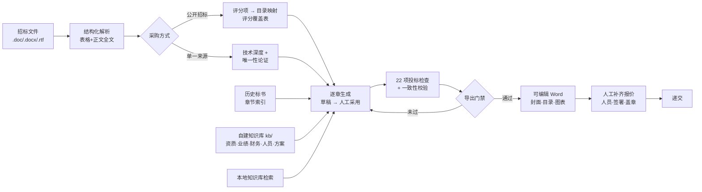

# longsky21/dsh-bidding

- **仓库名**：longsky21/dsh-bidding
- **原文链接**：https://github.com/longsky21/dsh-bidding
- **Star 数**：3（取自 GitHub 搜索 API，待核实）
- **最近更新时间**：2026-09-18T08:43:18Z
- **许可证**：MIT
- **语言**：JavaScript
- **质量分 / 适配分 / 混合分**：67.7 / 55.0 / 62.0
- **结论**：REVIEW
- **标记**：无
- **领域适配**：人工核验相关(强制收录)

## 用途摘要
行业无关的投标文件制作工作台：读招标文件 → 对齐评分标准 → 逐章生成 → 废标自查 → 导出可编辑 Word（LLM agent + 人在环）

## 适配理由
✓ 命中任务词：投标/文件；△ 未命中：ai/标技/技术/术文/件生/成与/与编/编写/写工

## README 要点
# 招标工作台 · Bidding Assistant

> 一个**行业无关**的投标文件制作工作台：把「读招标文件 → 对齐评分标准 → 逐章生成 → 废标自查 → 导出可编辑 Word」
> 串成一条可复核的流水线，让 AI 写标书这件事**可审计、可回滚、不瞎编**。
>
> 不绑定任何行业：知识库与术语规范由使用者自建——银行、制造、医疗、政企、工程、软件服务……只要能整理出
> 招标要求与自家素材，就能用同一套流程。（仓库自带的示例项目是"某银行金融科技系统建设"，仅作演示。）

[](LICENSE)
[](https://www.python.org/)
[](https://nodejs.org/)

[](#贡献)

**Bidding Assistant** is an industry-agnostic workbench for producing tender/bid documents with LLM agents.
It parses the invitation to bid, maps scoring criteria to chapters, drafts chapter by chapter with a human in
the loop, runs deterministic pre-submission checks, and exports an editable Word document — while keeping
human-only fields (price, personnel) unfilled and refusing to fabricate facts.


---

## 目录

- [它解决什么问题](#它解决什么问题)
- [截图](#截图)
- [核心能力](#核心能力)
- [工作流](#工作流)
- [快速开始](#快速开始)
- [试一试：内置演示项目](#试一试内置演示项目)
- [适配你自己的行业](#适配你自己的行业)
- [Skills 与提示词资产（可脱离 DSH 使用）](#skills-与提示词资产可脱离-dsh-使用)
- [目录结构](#目录结构)
- [工具清单](#工具清单)
- [它是怎么做到「不瞎编」的](#它是怎么做到不瞎编的)
- [质量红线与合规声明](#质量红线与合规声明)
- [路线图](#路线图)
- [排障记录](docs/troubleshooting.md)
- [贡献](#贡献)
- [许可](#许可)

---

## 它解决什么问题

做过投标的人大概都经历过这些：

| 痛点 | 现状 | 本项目的做法 |
|---|---|---|
| **招标文件太厚** | 200+ 页，评分表、技术规范、废标条款散在各处 | 结构化解析（表格 + 正文全文），抽出评分项、需求矩阵、废标条款、递交截止时间 |
| **写了不看评分** | 几十万字，评分项对不上，白写 | 评分项 → 章节映射 + 评分覆盖表，缺哪一项一屏可见 |
| **重复劳动** | 每份标书 80% 内容与上一份相似 | 历史标书按章节索引，**双通道复用**（叙述走 Markdown 改写；复杂表格/截图走 OOXML 原样搬运） |
| **一致性事故** | 复制来的段落里残留别家客户名 | 机构名一致性校验 + 替换规则（他方客户名一律改「某机构」，**绝不**改成当前采购人） |
| **废标级疏漏** | 资格材料缺失、响应表没逐条应答、报价超预算 | 22 项程序化检查，区分「不通过 / 待人工 / 未实现」，导出前设一道门禁 |
| **格式地狱** | Markdown 表格、流程图、代码块进 Word 就散了 | 导出器保留合并单元格语义；ASCII 图自动重排成 Word 表格；图片自动嵌入并生成图注 |

**它不做什么（诚实声明）**：不是「一键生成中标标书」。报价、拟投入人员、资质原件、签署日期这些
**只能人工确认**的内容，它一律留 `【待填】` 并在章末列出待补清单——填不完就不允许导出正式稿。

## 截图

| 逐章生成（章节清单 + 生成任务 + 未采用草稿） | 投标检查（22 项，区分不通过 / 待人工） |
|---|---|
|  |  |

| 文档输出（章节勾选、文件名分段、导出门禁） |
|---|
|  |

> 截图为**内置演示项目**（合成数据，项目名"某银行金融科技系统建设"），不含任何真实客户信息。

## 核心能力

- **招标文件结构化解析**：`.docx / .doc / .rtf` → JSON（表格全保留 + 正文全文 + 缺件信号）
- **评分覆盖与缺口分析**：评分项 / 招标要求 ×（参考标书 + 知识库）**确定性**对比，产出缺口清单
- **逐章生成（人在环）**：子 agent 只允许写 `output/章节/.draft/`，**人工点「采用」才替换正式章**（旧章自动备份）
- **双通道图文复用**：叙述内容走 Markdown 改写；含复杂表格/截图的整节走 OOXML 片段原样插入（图片关系重映射）
- **表单类章节填充**：投标函、开标一览表、偏离表、人员表、保证金、资格证明……**能填的填实**
  （主体信息、证书编号、保证金金额与账户、正副本份数），**报价与人签项一律留空**
- **交付前清理**：剥离内部注记与本地路径、图片按需压缩、ASCII 图重排、文件名规范化
- **检查与门禁**：22 项检查（响应表逐条、限价、机构名、占位符、图示、格式…），导出前给出可执行清单
- **技术标 / 商务标可分可合**：生成时可按册批量跑（只跑技术标或只跑商务标），导出时可选择**整本合成一个文件**、**只导其中一册**，或**分册各出一个 docx**（技术标/商务标分开装订的场合）
- **可回滚**：所有替换都留 `.bak-<时间戳>`；批量生成脚本脱离服务进程运行，跨重启存活

## 工作流



## 快速开始

### 环境要求

| 依赖 | 版本 | 用途 |
|---|---|---|
| Python | 3.9+ | 解析 / 校验 / 导出脚本（`python-docx`；可选 `Pillow` 做图片压缩） |
| Node.js | 20+ | 工作台插件（client 半区）+ 逐章生成驱动 |
| DeepSeek Harness (DSH) | 0.1.0-rc+ | 工作台宿主与子 agent 运行时（内部部署；**没有 DSH 也能用「方式 B」纯脚本**） |
| 本地知识库（可选） | — | 复用历史标书表述；任何支持问答式检索的本地库均可 |

```bash
git clone https://github.com/longsky21/dsh-bidding.git
cd dsh-bidding
pip install python-docx pillow
```

### 方式 A：装成 DSH 工作台（推荐）

```bash
# 1) 把插件装到 DSH profile（DSH 只从 profile 目录加载 client 插件）
bash tools/sync-plugin.sh push

# 2) 在 ~/.dsh/profiles/web/cordis.patch.yml 末尾追加（插件注册）
cat >> ~/.dsh/profiles/web/cordis.patch.yml <<'YAML'

# ── 招标工作台（Bid workbench）──────────────────────────────
- insert:
    - id: bidding-workbench
      name: 'dsh-bidding-workbench'
YAML

# 3) 重启 DSH Web
bash tools/restart-dsh-web.sh
```

打开 DSH Web → 任意会话 → 顶部页签 **「招标工作台」**。

> `bash tools/sync-plugin.sh check|push|pull` 三个方向分别是：比对、仓库→profile（部署）、profile→仓库（收拢改动）。
> **改 host 半区（`index.js`/`checks.js`/`export-plan.js` 等）需重启 DSH Web；只改 client 半区刷新浏览器即可。**

### 方式 B：只用命令行脚本

不需要 DSH 也能用（解析、校验、导出、缺口分析都是纯 Python）：

```bash
# 招标文件 → 结构化 JSON
python3 scripts/parse_tender.py input/招标文件.docx output/项目-结构化.json

# 招标要求 × 参考标书/知识库 → 响应缺口
python3 scripts/coverage_gap.py projects/我的项目

# 机构名一致性校验（历史标书的他方客户名残留会让标书"串门"）
python3 scripts/check_consistency.py projects/我的项目/output/章节/*.md \
    --meta projects/我的项目/output/项目-结构化.json

# 功能/技术响应表逐条核对（漏项/多项/空结论）
python3 scripts/check_response_table.py \
    --meta output/项目-结构化.json --chapter output/章节/03-系统功能模块及逐项响应.md

# 合并导出可编辑 Word（封面 + 目录 + 分部分 + 图表）
python3 scripts/export_bid.py --manifest manifest.json --out output/投标文件.docx \
    --project-root projects/我的项目
```

## 技术标 / 商务标分开，或合成一本

招标实务里两册经常分开装订、分开密封，有时只投其中一册。本项目两个环节都支持：

**① 生成**：章节页签有两个批量入口，互不影响（串行队列，一章完成再起下一章）

| 入口 | 覆盖章节 | 典型内容 |
|---|---|---|
| ⚡ 批量生成技术标 | `01~12` | 项目理解、平台架构、功能逐项响应、项目管理、实施计划、验收、售后、培训 |
| ⚡ 批量生成商务标 | `13~25` | 投标函、开标一览表、报价明细、偏离表、人员表、资格证明、保证金 |

命令行同理（`tools/gen-chapters.mjs`）：

```bash
node tools/gen-chapters.mjs --root projects/我的项目 --from 01 --to 12   # 只跑技术标
node tools/gen-chapters.mjs --root projects/我的项目 --nos 13,14,15      # 只跑指定商务标章节
```

**② 导出**：文档输出页签的「导出范围」四选一

| 范围 | 结果 |
|---|---|
| 整本 | 技术标 + 商务标**合成一个** docx（默认） |
| 只导技术标册 | 仅技术标章节，一个文件 |
| 只导商务标册 | 仅商务标章节，一个文件 |
| 分册导出 | **技术标、商务标各一个 docx**（文件名自动带 `-技术标` / `-商务标`） |

按册归类由结构表决定：技术标册 = `technical` + `service` 部分；商务标册 = `bid_letter` + `qualifica
...（截断，原文见链接）

## 核心代码片段（来源：README.md）
```javascript
# 招标工作台 · Bidding Assistant

> 一个**行业无关**的投标文件制作工作台：把「读招标文件 → 对齐评分标准 → 逐章生成 → 废标自查 → 导出可编辑 Word」
> 串成一条可复核的流水线，让 AI 写标书这件事**可审计、可回滚、不瞎编**。
>
> 不绑定任何行业：知识库与术语规范由使用者自建——银行、制造、医疗、政企、工程、软件服务……只要能整理出
> 招标要求与自家素材，就能用同一套流程。（仓库自带的示例项目是"某银行金融科技系统建设"，仅作演示。）

[](LICENSE)
[](https://www.python.org/)
[](https://nodejs.org/)

[](#贡献)

**Bidding Assistant** is an industry-agnostic workbench for producing tender/bid documents with LLM agents.
It parses the invitation to bid, maps scoring criteria to chapters, drafts chapter by chapter with a human in
the loop, runs deterministic pre-submission checks, and exports an editable Word document — while keeping
human-only fields (price, personnel) unfilled and refusing to fabricate facts.


---

## 目录

- [它解决什么问题](#它解决什么问题)
- [截图](#截图)
- [核心能力](#核心能力)
- [工作流](#工作流)
- [快速开始](#快速开始)
- [试一试：内置演示项目](#试一试内置演示项目)
- [适配你自己的行业](#适配你自己的行业)
- [Skills 与提示词资产（可脱离 DSH 使用）](#skills-与提示词资产可脱离-dsh-使用)
- [目录结构](#目录结构)
- [工具清单](#工具清单)
- [它是怎么做到「不瞎编」的](#它是怎么做到不瞎编的)
- [质量红线与合规声明](#质量红线与合规声明)
- [路线图](#路线图)
- [排障记录](docs/troubleshooting.md)
- [贡献](#贡献)
- [许可](#许可)

---

## 它解决什么问题

做过投标的人大概都经历过这些：

| 痛点 | 现状 | 本项目的做法 |
|---|---|---|
| **招标文件太厚** | 200+ 页，评分表、技术规范、废标条款散在各处 | 结构化解析（表格 + 正文全文），抽出评分项、需求矩阵、废标条款、递交截止时间 |
| **写了不看评分** | 几十万字，评分项对不上，白写 | 评分项 → 章节映射 + 评分覆盖表，缺哪一项一屏可见 |
| **重复劳动** | 每份标书 80% 内容与上一份相似 | 历史标书按章节索引，**双通道复用**（叙述走 Markdown 改写；复杂表格/截图走 OOXML 原样搬运） |
| **一致性事故** | 复制来的段落里残留别家客户名 | 机构名一致性校验 + 替换规则（他方客户名一律改「某机构」，**绝不**改成当前采购人） |
| **废标级疏漏** | 资格材料缺失、响应表没逐条应答、报价超预算 | 22 项程序化检查，区分「不通过 / 待人工 / 未实现」，导出前设一道门禁 |
| **格式地狱** | Markdown 表格、流程图、代码块进 Word 就散了 | 导出器保留合并单元格语义；ASCII 图自动重排成 Word 表格；图片自动嵌入并生成图注 |

**它不做什么（诚实声明）**：不是「一键生成中标标书」。报价、拟投入人员、资质原件、签署日期这些
**只能人工确认**的内容，它一律留 `【待填】` 并在章末列出待补清单——填不完就不允许导出正式稿。

## 截图

| 逐章生成（章节清单 + 生成任务 + 未采用草稿） | 投标检查（22 项，区分不通过 / 待人工） |
|---|---|
|  |  |

| 文档输出（章节勾选、文件名分段、导出门禁） |
|---|
|  |

> 截图为**内置演示项目**（合成数据，项目名"某银行金融科技系统建设"），不含任何真实客户信息。

## 核心能力

- **招标文件结构化解析**：`.docx / .doc / .rtf` → JSON（表格全保留 + 正文全文 + 缺件信号）
- **评分覆盖与缺口分析**：评分项 / 招标要求 ×（参考标书 + 知识库）**确定性**对比，产出缺口清单
- **逐章生成（人在环）**：子 agent 只允许写 `output/章节/.draft/`，**人工点「采用」才替换正式章**（旧章自动备份）
- **双通道图文复用**：叙述内容走 Markdown 改写；含复杂表格/截图的整节走 OOXML 片段原样插入（图片关系重映射）
- **表单类章节填充**：投标函、开标一览表、偏离表、人员表、保证金、资格证明……**能填的填实**
  （主体信息、证书编号、保证金金额与账户、正副本份数），**报价与人签项一律留空**
- **交付前清理**：剥离内部注记与本地路径、图片按需压缩、ASCII 图重排、文件名规范化
- **检查与门禁**：22 项检查（响应表逐条、限价、机构名、占位符、图示、格式…），导出前给出可执行清单
- **技术标 / 商务标可分可合**：生成时可按册批量跑（只跑技术标或只跑商务标），导出时可选择**整本合成一个文件**、**只导其中一册**，或**分册各出一个 docx**（技术标/商务标分开装订的场合）
- **可回滚**：所有替换都留 `.bak-<时间戳>`；批量生成脚本脱离服务进程运行，跨重启存活

## 工作流


## 快速开始

### 环境要求

| 依赖 | 版本 | 用途 |
|---|---|---|
| Python | 3.9+ | 解析 / 校验 / 导出脚本（`python-docx`；可选 `Pillow` 做图片压缩） |
| Node.js | 20+ | 工作台插件（client 半区）+ 逐章生成驱动 |
| DeepSeek Harness (DSH) | 0.1.0-rc+ | 工作台宿主与子 agent 运行时（内部部署；**没有 DSH 也能用「方式 B」纯脚本**） |
| 本地知识库（可选） | — | 复用历史标书表述；任何支持问答式检索的本地库均可 |

```bash
git clone https://github.com/longsky21/dsh-bidding.git
cd dsh-bidding
pip install python-docx pillow
```

### 方式 A：装成 DSH 工作台（推荐）

```ba
...（截断，原文见链接）
```
