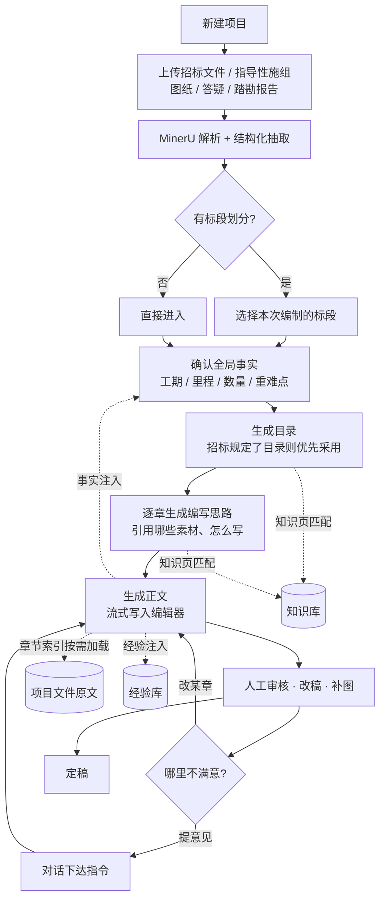

# zeronezer/bidcraft

- **仓库名**：zeronezer/bidcraft
- **原文链接**：https://github.com/zeronezer/bidcraft
- **Star 数**：79
- **最近更新时间**：2026-10-09T14:34:55Z
- **许可证**：Apache-2.0
- **语言**：Python
- **质量分 / 适配分 / 混合分**：78.8 / 47.9 / 64.9
- **结论**：ADOPT
- **标记**：无
- **命中子查询**：见适配理由

## 用途摘要
标书匠 BidCraft · 对话式标书编制系统：AI 智能编制技术标，支持招标文件解析、标段选择、标书编写、知识库提炼与学习对话式改稿。LLM-Wiki 路线，基于LangGraph实现。Open-source AI agent for construction tender & bid documents.

## 适配理由
✓ 命中任务词：标书；△ 未命中：招投/投标/电子/子投/标相/相关/关的/的开/开源/源库/库与/与工/关注/注投/标助/助手/暗标/书生

## README 要点
<div align="center">


# 标书匠 · BidCraft

**开源 · 对话式 · 工程标书编制智能体**

让 AI 写完技术标的初稿，你只做审核和补图。

[](LICENSE)
[](backend/requirements.txt)
[](frontend/package.json)
[](CONTRIBUTING.md)
[](#为什么开源)

[中文](README.md) · [English](README_EN.md)

</div>

---

## 它解决什么问题

做技术标的人都知道这份苦：

- 一本施工组织设计动辄 **几百页、几十万字**，其中真正"因项目而异"的可能不到 20%；
- 剩下 80% 是**抄改 + 拼装**：翻历史标书、翻工法库、把项目名和数字换一遍、调整章节顺序；
- 换个项目重来一遍，换个标段重来一遍，**经验留不下来**；
- 时间全耗在"复制粘贴 + 找素材"上，真正需要人来判断的地方——重难点分析、针对性措施——反而没时间深想。

**标书匠要做的事很具体：把"抄改拼装"这 80% 交给 AI 做掉，把人的时间还给那 20%。**

它不是"一键生成一篇通顺废话"的玩具。它围绕**工程文档的真实结构**设计：
招标文件怎么规定目录、标段怎么划分、哪些数字必须精确、哪些内容必须来自历史工法库、
哪些话不能写（废标风险）——这些都被建模进了编制流程里。

> **编制周期从"数周"压到"数天"，人是审核者与决策者，不是打字员。**

<table>
<tr>
<td width="50%"><br/><div align="center"><sub>三栏工作台：项目文件 · 目录树 · 正文编辑器 · 对话编制</sub></div></td>
<td width="50%"><br/><div align="center"><sub>AI 生成正文，直接落进所见即所得编辑器</sub></div></td>
</tr>
<tr>
<td width="50%"><br/><div align="center"><sub>说人话就行，工具执行过程可展开核对</sub></div></td>
<td width="50%"><br/><div align="center"><sub>流程／组织类关系图用 Mermaid 表达，编辑器内实时渲染</sub></div></td>
</tr>
<tr>
<td width="50%"><br/><div align="center"><sub>历史施组 → 结构化知识页（怎么写 / 要点 / 典型表图）</sub></div></td>
<td width="50%"><br/><div align="center"><sub>全局事实表：每条数字都有出处，可编辑、可追溯</sub></div></td>
</tr>
</table>

<sub>📷 以上截图均为**虚构演示项目**（云岭至江口高速公路 YJ-3 合同段），不含任何真实工程资料。</sub>

---

## 核心能力

| 能力 | 说明 |
|---|---|
| 📄 **招标文件解析** | PDF / 扫描件 / 图片型文件走 MinerU（OCR + 版面还原），Word / Excel 有各自更精确的解析通道。一份招标文件读进来，标段划分、评分办法、技术要求、编制要求、规定的目录结构全部结构化落库 |
| 🗂 **标段隔离** | 多标段项目选中一个标段后，事实、文件片段、知识素材全部按标段过滤——**正文里不会混进别的标段的工点** |
| 📚 **知识库（历史施组 → 知识页）** | 把你过去中标的施组喂进去，自动切成章节树，逐章提炼成"编制方式 + 要点 + 典型表格 + 图片 + 适用范围"的知识页。**越用越厚，越用越像你自己的风格** |
| 🔧 **工艺工法库** | 工法文档一篇一条概况索引，需要时整篇注入正文上下文 |
| 🌳 **目录生成** | 招标文件规定了目录就优先采用；没规定则按工程类型生成，逐级展开、流式"长出来" |
| 💡 **逐章编写思路** | 正文之前先生成"这一节打算怎么写、引用哪些素材"，可人工审阅调整——**先对齐思路，再动手写，避免几十万字写完才发现方向偏了** |
| ✍️ **正文流式生成** | 单章生成 / 批量生成 / 对话指定重写。正文直接流式写入所见即所得编辑器，生成完即可改 |
| 💬 **对话式编制** | 不说"点击按钮"，直接说人话："第三章重写一下，突出隧道超前地质预报"、"把工期那几个数字统一成 26 个月"。模型自主决定调哪些工具 |
| 🧾 **全局事实表** | 工期、里程、数量……这些数字单独抽出来管理，标明出处，正文引用可追溯，杜绝"同一个数在文档里出现三种写法" |
| 🎓 **经验学习** | 你每次改 AI 的稿子、否决一次生成、在对话里提一次意见，都会被提炼成"写法偏好"沉淀下来，下次生成自动遵守 |
| 📊 **Mermaid 关系图** | 流程 / 组织 / 职责类关系图用 Mermaid 表达，编辑器内实时渲染、双击改源码 |

---

## 操作流程



**一句话概括**：*上传 → 解析 → 选标段 → 确认事实 → 生成目录 → 过一遍思路 → 生成正文 → 改稿定稿*。

每个环节都可以停下人工干预，不需要"一键黑箱跑到底"。

---

## 快速开始

### 方式一：把项目丢给 AI 助手（最省事）⭐

本项目自带 [`AGENTS.md`](AGENTS.md)，Claude Code / Codex / Cursor / Trae / Windsurf / Cline 等 AI 编程助手会自动读取它。

```bash
git clone https://github.com/zeronezer/bidcraft.git
cd bidcraft
```

然后把目录丢给你的 AI 助手，说一句：

> **"按 AGENTS.md 把这个项目跑起来"**

它会自动检查运行时、装依赖、引导你填配置、建表、启动、并验证页面能打开。首次配置大约 10 分钟。

### 方式二：自己动手（4 步）

**第 1 步 · 准备**

```bash
git clone https://github.com/zeronezer/bidcraft.git
cd bidcraft
```

需要本机有 **Python ≥ 3.11**、**Node ≥ 18**、**MySQL 8**。

**第 2 步 · 装依赖**

```bash
pip install -r backend/requirements.txt
cd frontend && npm install && cd ..
```

**第 3 步 · 配置**

```bash
cp .env.example .env
```

打开 `.env`，填 3 处必填项：

| 配置项 | 去哪拿 | 是否必须 |
|---|---|---|
| `MYSQL_*` | 你本机/云上的 MySQL。先建库：`CREATE DATABASE bid_chat_db DEFAULT CHARSET utf8mb4;` | ✅ 必须 |
| `LLM_API_KEY` | [阿里云百炼](https://bailian.console.aliyun.com) → API-KEY 管理 | ✅ 必须 |
| `MINERU_API_TOKEN` | [mineru.net](https://mineru.net) → API 管理 → 创建 Token | ✅ 必须（不解析 PDF 可暂缺） |

> 💡 **想先看看界面？** 没有百炼 Key 和 MinerU Token 也能启动 —— 页面能打开、能新建项目，
> 只是上传解析和 AI 生成会失败。可以先跑通框架再补 Key。

**第 4 步 · 建表并启动**

```bash
python scripts/check_env.py --init-db   # 自检 + 建表（会逐项告诉你缺什么、去哪补）

# Windows
scripts\start_dev.bat

# macOS / Linux
bash scripts/start_dev.sh
```

浏览器打开 **http://127.0.0.1:5180** 即可。

<details>
<summary><b>方法三：完全手动启动（不用一键脚本）</b></summary>

```bash
# 终端 1 —— 后端
cd backend && python -m uvicorn app.main:app --reload --port 8000

# 终端 2 —— 前端
cd frontend && npm run dev
```
</details>

<details>
<summary><b>常见问题</b></summary>

| 现象 | 处理 |
|---|---|
| `Access denied for user` | `.env` 里 MySQL 账号密码不对 |
| `Unknown database 'bid_chat_db'` | 数据库还没建，见第 3 步 |
| 页面能开但接口 404 | 后端没起来，或不在 8000 端口 |
| 前端端口冲突 | 改 `frontend/vite.config.js` 里的 `server.port`（默认 5180） |
| 上传后一直"解析中" | MinerU Token 无效或额度不足，看后端终端日志 |
| MinerU 报 TLS/SSL 错误 | 本机代理污染了 CDN 的 DNS，在 `.env` 设 `MINERU_CDN_IPS=<真实IP>` |
| docx 解析失败 | docx 走 python-docx 原生解析，不需要本机装 Word/WPS；若报错请贴后端日志 |

更完整的排查见 [`AGENTS.md`](AGENTS.md#常见问题排查)。
</details>

---

## 标书编制智能体可调用的工具

对话栏里说的每句话，背后是模型在自主决定调用下面这些工具。**它们全部作用于真实数据，不是"假装执行"**——
模型声称"已生成第三章"，系统会核验本轮是否真有对应的工具成功记录，没有就否决并要求重做。

| 工具 | 作用 |
|---|---|
| `search_knowledge_pages` | 检索历史施组知识页（专业标签 + 标题相似度 + AI 终判三级漏斗） |
| `search_project_files` | 按章节索引查本项目文件**完整原文**（不切片、不截断） |
| `list_project_files
...（截断，原文见链接）

## 核心代码片段（来源：README_EN.md）
```python
<div align="center">


# BidCraft · 标书匠

**Open-source · Conversational · AI Agent for Engineering Bid Documents**

Let AI draft your technical proposal. You review and refine.

[](LICENSE)
[](backend/requirements.txt)
[](frontend/package.json)
[](CONTRIBUTING.md)
[](#why-open-source)

[中文](README.md) · [English](README_EN.md)

</div>

---

## The Problem It Solves

If you have ever prepared a technical bid for a construction project, you know the pain:

- A **Construction Organization Design** (施工组织设计) runs **hundreds of pages and hundreds of thousands of words** — yet under 20% of it is genuinely project-specific.
- The other 80% is **copy, adapt, assemble**: dig through past bids, dig through method statements, swap in the new project name and numbers, reorder sections.
- Start a new project, do it all again. Switch to a different lot, do it all again. **Nothing accumulates.**
- All the time goes into "find material + paste it", while the parts that actually need human judgement — risk analysis, project-specific countermeasures — get whatever time is left.

**BidCraft takes that 80% off your desk and gives your time back to the 20% that matters.**

This is not a "generate a fluent wall of text" toy. It models the **real structure of engineering documents**:
how the tender dictates the table of contents, how lots are divided, which numbers must be exact,
which content must come from your historical method library, which phrasing gets you disqualified —
all of that is built into the drafting pipeline.

> **Cut the drafting cycle from weeks to days. You become the reviewer and decision-maker, not the typist.**

<table>
<tr>
<td width="50%"><br/><div align="center"><sub>Three panes: files · outline · editor · chat</sub></div></td>
<td width="50%"><br/><div align="center"><sub>Generated text lands straight in the WYSIWYG editor</sub></div></td>
</tr>
<tr>
<td width="50%"><br/><div align="center"><sub>Just say it — tool execution is expandable and verifiable</sub></div></td>
<td width="50%"><br/><div align="center"><sub>Process/org diagrams as Mermaid, rendered live</sub></div></td>
</tr>
<tr>
<td width="50%"><br/><div align="center"><sub>Past proposals → structured knowledge pages</sub></div></td>
<td width="50%"><br/><div align="center"><sub>Every number has provenance; editable and traceable</sub></div></td>
</tr>
</table>

<sub>📷 All screenshots use a **fictional demo project** (Yunling–Jiangkou Expressway, Lot YJ-3). No real engineering documents are included.</sub>

---

## Core Capabilities

| Capability | Description |
|---|---|
| 📄 **Tender document parsing** | PDFs, scans and image-only files go through MinerU (OCR + layout reconstruction); Word/Excel have their own more precise channels. One upload yields structured lots, scoring rules, technical requirements, drafting requirements and the mandated table of contents |
| 🗂 **Lot isolation** | Once you pick a lot in a multi-lot project, facts, document excerpts and knowledge material are all filtered by lot — **no content from another lot leaks into your text** |
| 📚 **Knowledge base (past proposals → knowledge pages)** | Feed in proposals you have won before. They
...（截断，原文见链接）
```
