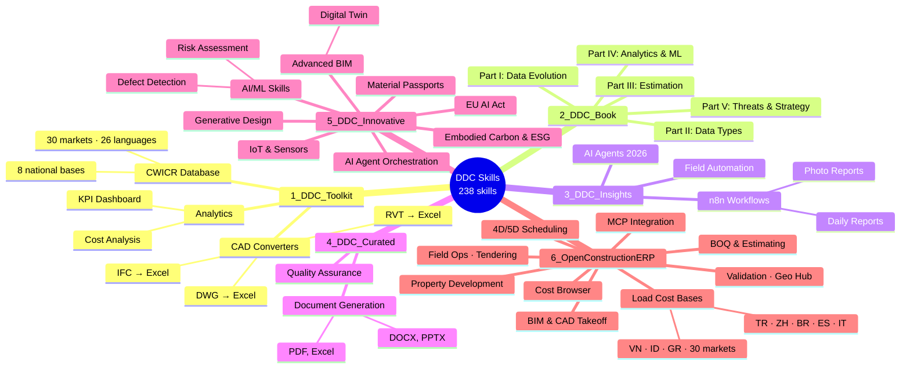

# datadrivenconstruction/DDC_Skills_for_AI_Agents_in_Construction

- **仓库名**：datadrivenconstruction/DDC_Skills_for_AI_Agents_in_Construction
- **原文链接**：https://github.com/datadrivenconstruction/DDC_Skills_for_AI_Agents_in_Construction
- **Star 数**：387（取自 GitHub 搜索 API；本环境数值可能偏高，待核实）
- **最近更新时间**：2026-10-19T16:57:53Z
- **许可证**：MIT
- **语言**：Python
- **质量分 / 适配分 / 混合分**：89.4 / 12.0 / 54.6
- **结论**：ADOPT
- **标记**：无
- **领域适配**：领域词:document control

## 用途摘要
221 AI skills for construction: BIM analysis, cost estimation, scheduling, document control, and automation with Claude Code

## 适配理由
⚠ 未命中任何任务关键词，可能不相关

## README 要点
<h1 align="center">DDC Skills Collection for AI Coding Assistants</h1>

<p align="center">
  <strong>AI Tools for Construction Company Automation</strong>
</p>

<p align="center">
  
  
  
  
</p>

<p align="center"></p>

<h3 align="center">Works with any AI coding assistant:</h3>

<p align="center">
  <a href="https://claude.ai/download"></a>
  <a href="https://antigravity.google/"></a>
  <a href="https://github.com/nicepkg/opencode"></a>
  <a href="https://github.com/clawdbot/clawdbot"></a>
</p>

---

## What is this?

A collection of **238 skills** for automating construction company processes with AI coding assistants.

### What is a "Skill"?

A skill is a `SKILL.md` file — structured instructions that an AI coding assistant can read and execute. Each skill describes a specific task: what problem it solves, what code to generate, and what tools are needed. You open a skill folder in your AI assistant, and it helps you implement the described functionality.

---

## Collection Structure

Skills are organized by source and complexity level:

| Category | What's inside | Skills | Start here if... |
|----------|---------------|--------|------------------|
| **1_DDC_Toolkit** | Production-ready tools: CWICR database, CAD converters, analytics | 85 | You need a working tool now |
| **2_DDC_Book** | Skills mapped to book chapters: data evolution, types, estimation, ML | 67 | You want to follow a structured learning path |
| **3_DDC_Insights** | Practical workflows: n8n automation, AI agents, field tools | 20 | You need workflow automation |
| **4_DDC_Curated** | Document generation (PDF, Excel, DOCX, PPTX), quality checks | 20 | You need document or report templates |
| **5_DDC_Innovative** | Advanced: computer vision, IoT, digital twins, risk assessment, AI agents, ESG, EU AI Act, circular construction, generative design | 34 | You're ready for AI/ML experimentation |
| **6_OpenConstructionERP** | Work with the OpenConstructionERP platform: load cost bases, BOQ & estimating, BIM takeoff, 4D/5D, cost browser, MCP, field ops, tendering, validation, geo/coordination, property development | 12 | You build on the open-source construction ERP |



---

## Where to Start

### If you manage or lead a construction company:

**Step 1.** Read [GETTING_STARTED.md](GETTING_STARTED.md) — a non-technical overview of what can be automated and how to prioritize.

**Step 2.** Download the [Data-Driven Construction](Books/) book (free, 31 languages) — it explains the methodology behind these skills: how to assess your company's data maturity, identify bottlenecks, and plan digital transformation.

**Step 3.** Identify your biggest pain point in the table below and start with the corresponding skill.

### If you are a developer or IT lead:

**Step 1.** Install prerequisites (see [Prerequisites](#prerequisites)).

**Step 2.** Pick a skill from the table below, open its folder in your AI assistant, and follow the `SKILL.md`.

**Step 3.** Adapt the generated code to your data and deploy.

---

## What Can You Automate?

Examples of common problems and which skills address them:

| Your problem | What the skill does | Skill to run | Folder |
|--------------|---------------------|--------------|--------|
| Searching for work item rates takes too long | Semantic search across 78,228 national + 55,719 global items in 26 languages | `semantic-search-cwicr` | `1_DDC_Toolkit/` |
| Estimators spend days building estimates manually | Generates estimates from historical data and templates | `estimate-builder` | `1_DDC_Toolkit/` |
| BIM models contain data but it's locked in RVT/IFC files | Extracts quantities and proper
...（截断，原文见链接）

## 核心代码片段（来源：README.md）
```python
<h1 align="center">DDC Skills Collection for AI Coding Assistants</h1>

<p align="center">
  <strong>AI Tools for Construction Company Automation</strong>
</p>

<p align="center">
  
  
  
  
</p>

<p align="center"></p>

<h3 align="center">Works with any AI coding assistant:</h3>

<p align="center">
  <a href="https://claude.ai/download"></a>
  <a href="https://antigravity.google/"></a>
  <a href="https://github.com/nicepkg/opencode"></a>
  <a href="https://github.com/clawdbot/clawdbot"></a>
</p>

---

## What is this?

A collection of **238 skills** for automating construction company processes with AI coding assistants.

### What is a "Skill"?

A skill is a `SKILL.md` file — structured instructions that an AI coding assistant can read and execute. Each skill describes a specific task: what problem it solves, what code to generate, and what tools are needed. You open a skill folder in your AI assistant, and it helps you implement the described functionality.

---

## Collection Structure

Skills are organized by source and complexity level:

| Category | What's inside | Skills | Start here if... |
|----------|---------------|--------|------------------|
| **1_DDC_Toolkit** | Production-ready tools: CWICR database, CAD converters, analytics | 85 | You need a working tool now |
| **2_DDC_Book** | Skills mapped to book chapters: data evolution, types, estimation, ML | 67 | You want to follow a structured learning path |
| **3_DDC_Insights** | Practical workflows: n8n automation, AI agents, field tools | 20 | You need workflow automation |
| **4_DDC_Curated** | Document generation (PDF, Excel, DOCX, PPTX), quality checks | 20 | You need document or report templates |
| **5_DDC_Innovative** | Advanced: computer vision, IoT, digital twins, risk assessment, AI agents, ESG, EU AI Act, circular construction, generative design | 34 | You're ready for AI/ML experimentation |
| **6_OpenConstructionERP** | Work with the OpenConstructionERP platform: load cost bases, BOQ & estimating, BIM takeoff, 4D/5D, cost browser, MCP, field ops, tendering, validation, geo/coordination, property development | 12 | You build on the open-source construction ERP |

```mermaid
mindmap
  root((DDC Skills<br/>238 skills))
    1_DDC_Toolkit
      CWICR Database
        8 national bases
        30 markets · 26 languages
      CAD Converters
        RVT → Excel
        IFC → Excel
        DWG → Excel
      Analytics
        KPI Dashboard
        Cost Analysis
    2_DDC_Book
      Part I: Data Evolution
      Part II: Data Types
      Part III: Estimation
      Part IV: Analytics & ML
      Part V: Threats & Strategy
    3_DDC_Insights
      n8n Workflows
        Daily Reports
        Photo Reports
      AI Agents 2026
      Field Automation
    4_DDC_Curated
      Document Generation
        PDF, Excel
        DOCX, PPTX
      Quality Assurance
    5_DDC_Innovative
      AI/ML Skills
        Defect D
...（截断，原文见链接）
```
