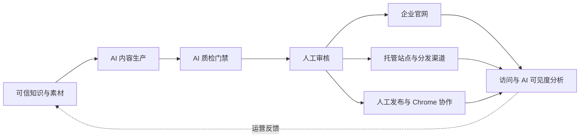

> 【审计剔除 · 2026-11-11】初版闸门因泛化英文词（engineer/cms/archive）误收，经人工核对与「工程资料管理」主题无关，移入 _excluded 留痕。原路径 05_工程资料管理/yaojingang__GEOFlow.md。

# yaojingang/GEOFlow

- **仓库名**：yaojingang/GEOFlow
- **原文链接**：https://github.com/yaojingang/GEOFlow
- **Star 数**：4058（取自 GitHub 搜索 API；本环境数值可能偏高，待核实）
- **最近更新时间**：2026-11-10T00:58:56Z
- **许可证**：AGPL-3.0
- **语言**：PHP
- **质量分 / 适配分 / 混合分**：97.1 / 12.0 / 58.8
- **结论**：ADOPT
- **标记**：无
- **领域适配**：领域词:engineer/cms

## 用途摘要
Open-source GEO content engineering and multi-site distribution platform with AI quality inspection, illustrated admin help, hosted sites, browser-assisted publishing, and signed updates.

## 适配理由
⚠ 未命中任何任务关键词，可能不相关

## README 要点
# GEOFlow 3.2.1

> Languages: [简体中文](README.md) | [English](docs/readme/README_en.md) | [日本語](docs/readme/README_ja.md) | [Español](docs/readme/README_es.md) | [Русский](docs/readme/README_ru.md) | [Português (BR)](docs/readme/README_pt_BR.md)

## 60 秒了解 GEOFlow

从可信知识到 AI 内容生产、质量门禁、人工审核与多站点分发，60 秒看懂企业官网的 GEO 运营流程。

https://github.com/user-attachments/assets/8dbbf34e-e9c1-4139-977a-8e78394e34d9

*中文介绍 · 60 秒*

---

> 面向企业官网的开源 GEO 智能运营系统

GEOFlow 把企业知识导入、AI 文章与专题生产、智能配图、质量门禁、人工审核、多站点分发和 AI 可见性分析接进一条运营链路。品牌、增长和内容团队可以用它建设企业官网、GEO 子频道、行业信源站或内部内容运营平台，在同一套后台管理资料来源、内容版本、发布结果和运营数据。

[快速开始](#快速开始) · [界面预览](#界面预览) · [核心能力](#geoflow-321-核心能力) · [文档中心](docs/README.md) · [3.0 升级教程](docs/deployment/GEOFLOW_V3_UPGRADE.md) · [蓝绿部署与自动迁移](docs/blue-green-deployment-usage.md) · [更新日志](docs/CHANGELOG.md) · [官方网站](https://www.geoflow.me)

[](version.json)
[](https://github.com/yaojingang/GEOFlow/releases/latest)
[](https://www.php.net/)
[](https://github.com/yaojingang/GEOFlow/actions/workflows/ci.yml)
[](LICENSE)
[](https://github.com/yaojingang/GEOFlow/stargazers)

> **版本说明：** 当前源码版本为正式版 `3.2.1`。精确版本见 [`version.json`](version.json)，发布包与对应升级说明见 [GitHub Releases](https://github.com/yaojingang/GEOFlow/releases)。`main` 持续接收后续更新，部署时请固定 Release 标签或经过审核的提交。

---

## GEOFlow 解决什么问题

企业开展 GEO 运营时，通常需要同时管理品牌知识、模型、内容生产、质量审核、官网工程、渠道发布和效果分析。工具分散会让资料来源、审核结论和发布结果难以追踪。

GEOFlow 把这些工作放进同一个管理后台：



系统保留知识来源、任务配置、模型调用、质检证据、人工放行、发布状态和渠道日志，方便团队持续复盘和维护内容资产。

---

## 界面预览

<table>
  <tr>
    <td width="50%"><br /><sub>图文帮助工作台</sub></td>
    <td width="50%"><br /><sub>数据中心</sub></td>
  </tr>
  <tr>
    <td width="50%"><br /><sub>任务管理</sub></td>
    <td width="50%"><br /><sub>文章 AI 质检</sub></td>
  </tr>
  <tr>
    <td width="50%"><br /><sub>托管渠道站点</sub></td>
    <td width="50%"><br /><sub>人工发布工作台</sub></td>
  </tr>
</table>

这些脱敏界面来自 3.0 内置帮助素材，覆盖知识问答、任务调度、文章质检、托管站点、人工发布和数据分析等主要流程。

---

## GEOFlow 3.2.1 核心能力

| 能力 | 当前提供的工作方式 |
|------|-------------------|
| 可信知识与内容生产 | 导入 TXT、Markdown、DOCX、PDF 和 PPTX，管理知识库、标题、关键词、图片、作者、提示词和模型；支持向量检索、图片库智能配图及提示词实时测试 |
| AI 质量门禁 | 按知识证据、数据与引文、广告规则和发布语境检查文章，记录评分、原文定位、修改建议及历史结果；支持自动优化、按分数放行和人工审核 |
| 专题管理与持续维护 | 将已有文章组织为专题，支持 AI 生成、选文分组、审核发布和定期维护，提供标准卡片、阅读指南和时间汇总三种阅读布局 |
| 审核与运营协作 | 管理草稿、发布、回收站和批量导出；平台网页渠道将头条号、搜狐号和网易号分发转为人工工单，通过 Chrome 运营助手领取并提交回执 |
| 企业官网与多站点交付 | 输出 SEO 元信息、Open Graph、Schema、抓取发现文件和规范链接；支持模板包、短视频、托管站点、GEOFlow Agent、WordPress REST 和通用 HTTP API |
| 链接池与推荐投放 | 为主站与第一方托管站管理内链和经健康检查的外部链接，按分类、关键词和活动规则投放推荐，查看输出、可见和点击数据 |
| AI 可见性与日常运维 | 分析关键词采样、专题、信源、竞品、词云、访问及 AI 爬虫；独立 Updater 负责签名更新、完整备份、环境验收和恢复点回滚 |
| 团队与开发者入口 | Admin UI V3 支持六种语言、响应式布局、PWA 和图文帮助；API v1、CLI 与 Agent Skill 提供现有内容管理自动化、远程主题草稿和签名预览 |

部署并完成基础站点设置后，主站和托管站会自动提供 `/robots.txt`、`/sitemap.xml`、`/sitemap.txt` 和 `/llms.txt`。这些地址按当前站点、发布状态、索引开关、规范化文章链接和站点设置实时生成；GEOFlow Agent 目标站点包在安装时提供这四个地址，并在文章发布、删除和站点设置同步时自动刷新 XML 与文本地图及 `llms.txt`。页面的标题、描述、规范链接、Open Graph 和 JSON-LD 继续由公共前台层统一输出。

`robots.txt` 会自动限制后台、API、运行时调试、上传存储、搜索参数和图片文件的抓取，并拒绝 Facebook 分享抓取器；这些规则只管理爬虫访问意向，敏感数据仍须使用认证、授权和服务器访问控制保护。

### 3.2.1 汇总的近期更新

- 专题管理与 AI 专题任务：支持文章二次组合、分组排序、批量创建、审核发布和定期维护，并接入首页、导航、文章回链与 Sitemap。
- 链接池：支持链接导入预检、推荐活动、站点开关、主题适配与回滚，以及推荐输出、读者可见和点击统计。
- 提示词实时测试：直接测试未保存草稿，结合知识库与选题流式生成正文，支持停止运行和带原文定位的 AI 诊断。
- 知识导入：知识库与企业知识新增 PDF、PPTX 文本提取，保留 TXT、Markdown 和 DOCX 支持；扫描件与纯图片文档需先完成 OCR。
- 智能配图：模型根据图片库备注和标签选择正文配图，按任务数量限制输出；未选图时使用间隔插入作为回退。
- 平台人工辅助发布：头条号、搜狐号和网易号通过人工工单、Chrome 运营助手及结果回执完成分发，最终发布由运营人员确认。
- AI 可见性：增加专题归类、信源与竞品证据、词云清洗，以及近 7 天成功采样标记和手动重采。
- 模板与前台：提供精选、我的模板和归档分区，支持经校验的短视频；模板包默认兼容 3.x，继续校验作者声明的最低版本和功能依赖。
- 发布与运行修复：完善文章批量操作、AI 评分放行和自动发布，修复火山方舟多模态向量接入，增加按主机启用的出站代理并更新安全依赖。

功能使用说明见[链接池与提示词测试](docs/operations/link-pool-and-prompt-test.md)、[知识文档导入](docs/knowledge-import.md)、[平台人工辅助发布](docs/distribution/platform-web-assisted-publishing.md)及 [AI 可见性](docs/ai-visibility-operations.md)。CLI 和 Skill 继续使用各自的预览版本，远程主题发布与回滚的当前范围见[远程管理说明](docs/api/remote-management-preview.md)。

完整变更见 [中文更新日志](docs/CHANGELOG.md) 和 [English changelog](docs/CHANGELOG_en.md)。

---

## 适用场景

| 场景 | 建议用法 | 重点能力 |
|------|----------|----------|
| 企业官网 GEO 运营 | 围绕产品、案例、FAQ、行业知识和品牌规则持续建设内容 | 企业知识库、任务、质检、官网发布、数据分析 |
| 官网 GEO 子频道 | 通过子域名或独立目录快速建立资讯、知识或解决方案频道 | 主题、栏目、SEO、内容调度、线索表单 |
| 行业信源站 | 围绕一个行业、主题或问题域维护可核验的长期内容资产 | RAG、审核、引用友好输出、sitemap、`llms.txt` |
| 内部内容运营平台 | 弱化公开前台，由品牌、增长和内容团队统一生产与审核 | 素材库、API、CLI、人工发布、权限和审计 |
| 多品牌与多站点 | 从一套后台管理多个站点、栏目或内容出口 | 托管站点、Agent、WordPress、通用 API、分发日志 |

GEOFlow 适合拥有真实业务资料、明确审核责任和持续运营计划的团队。知识库质量、人工判断和长期维护决定内容能否稳定获得用户与 AI 的信任。

---

## 安全与治理

| 范围 | 设计边界 |
|------|----------|
| 内容质量 | 知识证据、规则版本、评分、人工放行和结果过期均可追踪 |
| 账号与权限 | 管理入口按权限过滤，敏感操作由超级管理员控制，任务和人工发布保留状态历史 |
| 浏览器协作 | Chrome 扩展使用设备配对与最小权限 Token，不保存外部平台密码、Cookie 或 OAuth 凭证 |
| 出站请求 | URL 导入、分发、AI、主题
...（截断，原文见链接）

## 核心代码片段（来源：README.md）
```php
# GEOFlow 3.2.1

> Languages: [简体中文](README.md) | [English](docs/readme/README_en.md) | [日本語](docs/readme/README_ja.md) | [Español](docs/readme/README_es.md) | [Русский](docs/readme/README_ru.md) | [Português (BR)](docs/readme/README_pt_BR.md)

## 60 秒了解 GEOFlow

从可信知识到 AI 内容生产、质量门禁、人工审核与多站点分发，60 秒看懂企业官网的 GEO 运营流程。

https://github.com/user-attachments/assets/8dbbf34e-e9c1-4139-977a-8e78394e34d9

*中文介绍 · 60 秒*

---

> 面向企业官网的开源 GEO 智能运营系统

GEOFlow 把企业知识导入、AI 文章与专题生产、智能配图、质量门禁、人工审核、多站点分发和 AI 可见性分析接进一条运营链路。品牌、增长和内容团队可以用它建设企业官网、GEO 子频道、行业信源站或内部内容运营平台，在同一套后台管理资料来源、内容版本、发布结果和运营数据。

[快速开始](#快速开始) · [界面预览](#界面预览) · [核心能力](#geoflow-321-核心能力) · [文档中心](docs/README.md) · [3.0 升级教程](docs/deployment/GEOFLOW_V3_UPGRADE.md) · [蓝绿部署与自动迁移](docs/blue-green-deployment-usage.md) · [更新日志](docs/CHANGELOG.md) · [官方网站](https://www.geoflow.me)

[](version.json)
[](https://github.com/yaojingang/GEOFlow/releases/latest)
[](https://www.php.net/)
[](https://github.com/yaojingang/GEOFlow/actions/workflows/ci.yml)
[](LICENSE)
[](https://github.com/yaojingang/GEOFlow/stargazers)

> **版本说明：** 当前源码版本为正式版 `3.2.1`。精确版本见 [`version.json`](version.json)，发布包与对应升级说明见 [GitHub Releases](https://github.com/yaojingang/GEOFlow/releases)。`main` 持续接收后续更新，部署时请固定 Release 标签或经过审核的提交。

---

## GEOFlow 解决什么问题

企业开展 GEO 运营时，通常需要同时管理品牌知识、模型、内容生产、质量审核、官网工程、渠道发布和效果分析。工具分散会让资料来源、审核结论和发布结果难以追踪。

GEOFlow 把这些工作放进同一个管理后台：


系统保留知识来源、任务配置、模型调用、质检证据、人工放行、发布状态和渠道日志，方便团队持续复盘和维护内容资产。

---

## 界面预览

<table>
  <tr>
    <td width="50%"><br /><sub>图文帮助工作台</sub></td>
    <td width="50%"><br /><sub>数据中心</sub></td>
  </tr>
  <tr>
    <td width="50%"><br /><sub>任务管理</sub></td>
    <td width="50%"><br /><sub>文章 AI 质检</sub></td>
  </tr>
  <tr>
    <td width="50%"><br /><sub>托管渠道站点</sub></td>
    <td width="50%"><br /><sub>人工发布工作台</sub></td>
  </tr>
</table>

这些脱敏界面来自 3.0 内置帮助素材，覆盖知识问答、任务调度、文章质检、托管站点、人工发布和数据分析等主要流程。

---

## GEOFlow 3.2.1 核心能力

| 能力 | 当前提供的工作方式 |
|------|-------------------|
| 可信知识与内容生产 | 导入 TXT、Markdown、DOCX、PDF 和 PPTX，管理知识库、标题、关键词、图片、作者、提示词和模型；支持向量检索、图片库智能配图及提示词实时测试 |
| AI 质量门禁 | 按知识证据、数据与引文、广告规则和发布语境检查文章，记录评分、原文定位、修改建议及历史结果；支持自动优化、按分数放行和人工审核 |
| 专题管理与持续维护 | 将已有文章组织为专题，支持 AI 生成、选文分组、审核发布和定期维护，提供标准卡片、阅读指南和时间汇总三种阅读布局 |
| 审核与运营协作 | 管理草稿、发布、回收站和批量导出；平台网页渠道将头条号、搜狐号和网易号分发转为人工工单，通过 Chrome 运营助手领取并提交回执 |
| 企业官网与多站点交付 | 输出 SEO 元信息、Open Graph、Schema、抓取发现文件和规范链接；支持模板包、短视频、托管站点、GEOFlow Agent、WordPress REST 和通用 HTTP API |
| 链接池与推荐投放 | 为主站与第一方托管站管理内链和经健康检查的外部链接，按分类、关键词和活动规则投放推荐，查看输出、可见和点击数据 |
| AI 可见性与日常运维 | 分析关键词采样、专题、信源、竞品、词云、访问及 AI 爬虫；独立 Updater 负责签名更新、完整备份、环境验收和恢复点回滚 |
| 团队与开发者入口 | Admin UI V3 支持六种语言、响应式布局、PWA 和图文帮助；API v1、CLI 与 Agent Skill 提供现有内容管理自动化、远程主题草稿和签名预览 |

部署并完成基础站点设置后，
...（截断，原文见链接）
```
